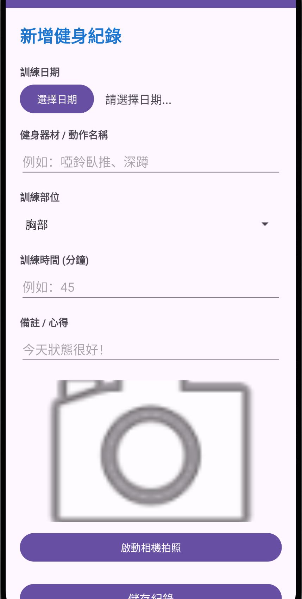
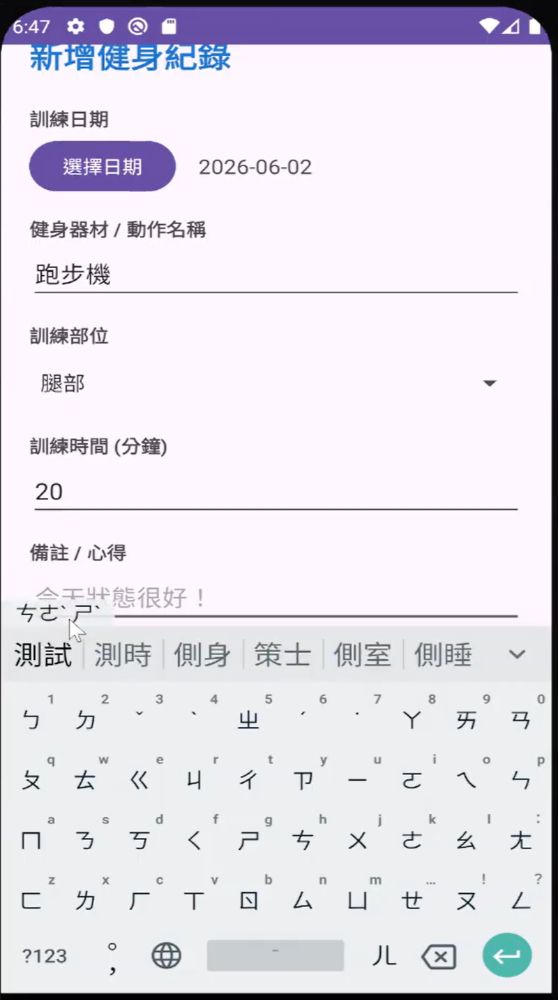
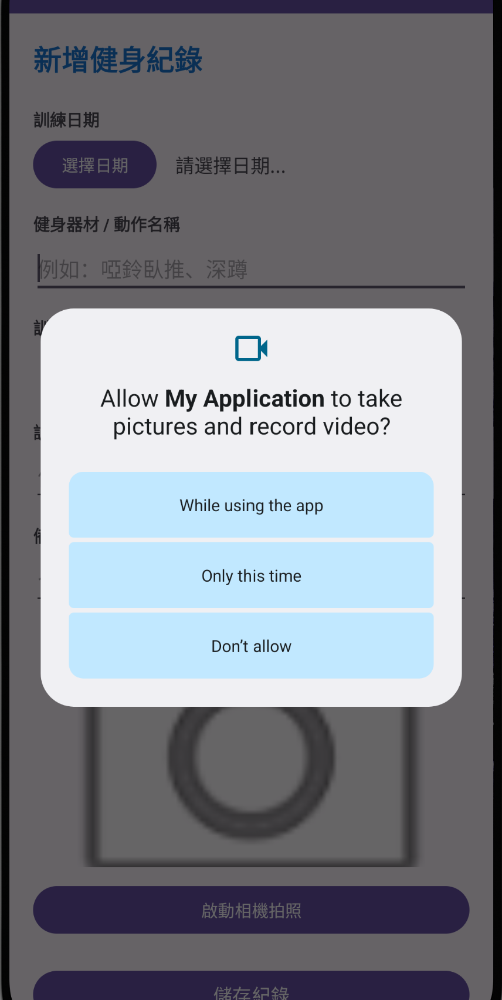
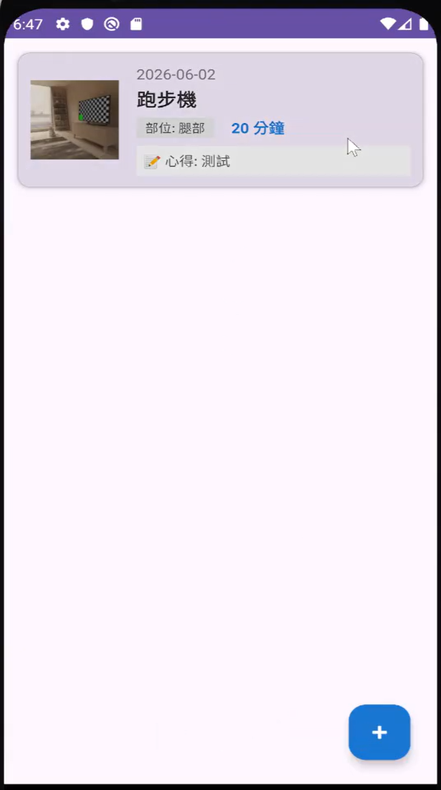

# 健身紀錄 App

使用 Android Studio 與 Kotlin 製作的 Android 健身紀錄專案，讓使用者記錄每次訓練的日期、器材或動作、訓練部位、時間與心得，並可附上拍攝的照片。

## 主要功能

- **新增訓練紀錄**：選擇日期，輸入健身器材或動作名稱與訓練時間（分鐘）。
- **選擇訓練部位**：包含胸部、背部、腿部、肩部、手臂與核心。
- **填寫心得**：可選擇加入訓練備註。
- **拍照與預覽**：取得相機權限後拍攝照片，儲存相機回傳的縮圖並附加至紀錄。
- **瀏覽紀錄**：使用清單顯示訓練內容與照片縮圖，沒有紀錄時顯示提示。
- **刪除紀錄**：長按紀錄開啟確認視窗，確認後刪除。
- **本機儲存**：以 SQLite 儲存紀錄，照片另外儲存在 App 專用檔案目錄。

## 使用方式

1. 開啟 App，點擊新增按鈕。
2. 選擇日期，輸入器材或動作名稱、訓練時間，並選擇訓練部位。
3. 視需要輸入心得，或允許相機權限後拍照。
4. 點擊儲存，返回首頁查看紀錄。
5. 如需刪除，長按該筆紀錄並確認。

## App 畫面

### 新增健身紀錄

選擇訓練日期，輸入器材或動作名稱、訓練部位、時間與心得，並可拍照附加至紀錄。



### 輸入訓練內容

填寫訓練資料，例如跑步機、腿部訓練及 20 分鐘的訓練時間。



### 相機權限請求

首次使用拍照功能時，App 會請求相機權限，取得允許後即可啟動相機。



### 新增後的紀錄清單

儲存後返回首頁，以卡片顯示日期、器材或動作、訓練部位、時間、心得與照片縮圖。



## 開發工具與技術

- Android Studio
- Kotlin
- XML 版面配置與 View Binding
- RecyclerView 清單
- SQLiteOpenHelper 本機資料庫
- Activity Result API 與相機權限處理

## 專案結構

```text
app/src/main/
├── AndroidManifest.xml
├── java/
│   ├── com/example/myapplication/
│   │   ├── MainActivity.kt          # 紀錄清單與刪除確認
│   │   ├── AddRecordActivity.kt     # 新增紀錄、日期選擇與拍照
│   │   └── FitnessAdapter.kt        # 清單資料顯示
│   └── data/
│       ├── DatabaseHelper.kt       # SQLite 新增、查詢與刪除
│       └── FitnessRecord.kt        # 訓練紀錄資料模型
└── res/                            # 畫面配置與資源
```

## 開啟專案

1. 下載並解壓縮專案，使用 Android Studio 開啟含有 `settings.gradle.kts` 的資料夾。
2. 依 Android Studio 提示設定本機 Android SDK 並完成 Gradle 同步；首次同步需要網路下載相關套件。
3. 專案設定使用 Compile SDK 35，最低支援 Android 7.0（API 24）。
4. 選擇模擬器或 Android 裝置執行；拍照功能需要可用的相機與使用者授權。

本機 SDK 路徑設定檔 `local.properties` 不包含在儲存庫中，請由自己的開發環境設定。

## 目前範圍

- 已實作新增、瀏覽與刪除，尚未提供編輯紀錄或雲端同步。
- 目前 App 顯示名稱仍為 `My Application`。
- 目前資料庫升級程式會重建資料表，升級時會清除舊紀錄。
- 本 README 依原始程式內容整理，尚未在本次整理中完成編譯或裝置執行驗證。
